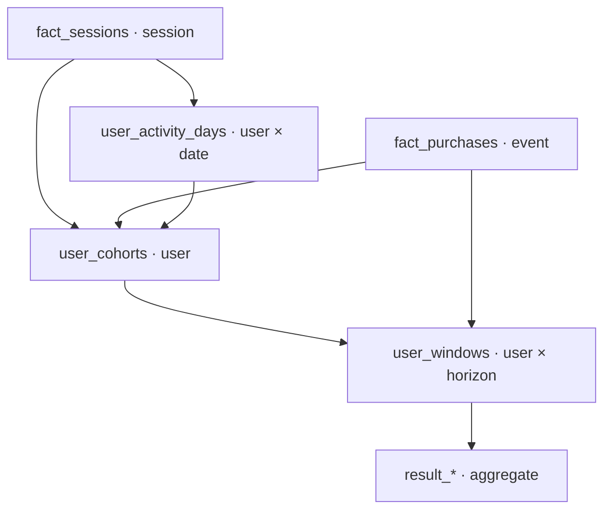

# Schema và hợp đồng join

Các CSV gốc có header/schema lưu tại `audit/input_schema.json`. SQL `00_load_audited.sql` khai báo kiểu cho mọi cột, không để engine đoán kiểu ID.

| Bảng | Grain/khóa | Dùng cho |
|---|---|---|
| `fact_sessions` | một `session_id` duy nhất, user nhiều session | Anchor, ngày hoạt động, kênh/thiết bị |
| `fact_purchases` | một `purchase_key` theo dòng nguồn | Ngày purchase và recorded USD revenue |
| `dim_channel` | một `channel_id` | Nhãn first-user channel đã audit |
| `dim_device` | một `device_id` | Nhãn thiết bị |
| `dim_geo`, `dim_date` | khóa dimension tương ứng | Giữ trọn dữ liệu upstream; không phải biến phân tích chính ở case này |
| `observation_window` | một dòng | Ngày bắt đầu/kết thúc của session snapshot |
| `analysis_horizons` | một dòng cho 7/14/30 | Cấu hình horizon |
| `user_activity_days` | user × session date | `LAG`, khoảng cách giữa ngày có session |
| `user_cohorts` | một user | Anchor, first return/purchase, flags quality |
| `user_windows` | user × horizon | Eligibility và outcome NULL/TRUE/FALSE |

`fact_purchases.session_id` phải khớp `fact_sessions.session_id`; user ID ở hai phía phải bằng nhau. Không join nhiều dòng purchase vào nhiều session chỉ bằng user ID để tính tiền: SQL aggregate purchase theo user trước khi xây profile, và theo user × horizon trước khi join cửa sổ.

## Cột quan trọng của user_cohorts

| Cột | Kiểu | Ý nghĩa |
|---|---|---|
| `user_id` | VARCHAR | Pseudonymous ID của nguồn |
| `first_observed_date` | DATE | Ngày session đầu có trong snapshot |
| `cohort_month` | DATE | Ngày đầu tháng của anchor |
| `anchor_session_id` | VARCHAR | Session được chọn theo date rồi ID |
| `anchor_channel_id`, `anchor_device_id` | BIGINT | Khóa dimension trên anchor session |
| `anchor_new_user_flag` | BIGINT | Cờ GA4 upstream được giữ; không tự đặt thành 1 |
| `observed_channel_variants` | BIGINT | Số channel ID khác nhau trong quan sát |
| `anchor_day_channel_variants` | BIGINT | Số channel trên ngày anchor |
| `first_return_date` | DATE/NULL | Ngày session đầu tiên nằm sau D0 |
| `days_to_first_return` | BIGINT/NULL | Calendar-day difference; luôn >0 nếu có return |
| `first_purchase_date` | DATE/NULL | Ngày purchase đầu trong snapshot |
| `days_to_first_purchase` | BIGINT/NULL | Calendar-day difference; dữ liệu trước anchor phải bị phát hiện |
| `observed_purchase_revenue_usd` | DECIMAL | Tổng recorded purchase-event USD của user |

## Cột bổ sung của user_windows

`horizon_days`, `window_end`, `is_eligible`; `returned_by_horizon` và `purchased_by_horizon` là BOOLEAN/NULL; `purchase_events_by_horizon` là count/NULL; `purchase_revenue_by_horizon_usd` là DECIMAL/NULL. Khi `is_eligible = false`, toàn bộ outcome giữ NULL.

Sơ đồ join chính:

Xem `docs/upstream_reference/DATA_DICTIONARY.md` cho đầy đủ định nghĩa các cột upstream. Tài liệu upstream mô tả Power BI, không thay thế phương pháp cohort mới.
