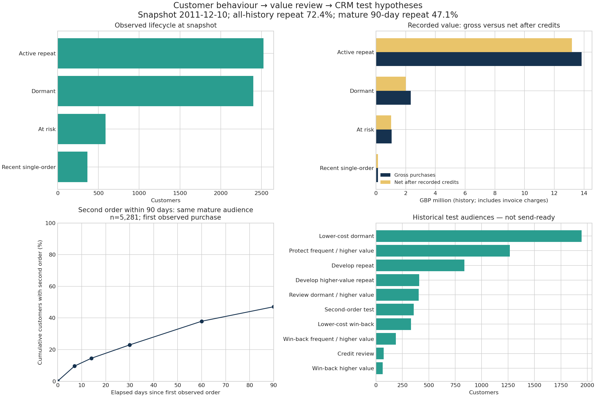

# Customer Lifecycle, RFM & Retention — Remaster

**Customer & Growth Analytics · Python / pandas / SQLite QA · Standalone takeover 2026-10-15 (analytical core 1.0.2)**

Current standalone handoff: read `START_HERE_VI.md` and `audit/AUDIT_REPORT.md`. The consolidated runner records pipeline, fixtures, SQL validation and fresh notebook execution. It explicitly blocks notebook completion when dependencies are absent. Historical evidence is retained under `audit/history/` and is not presented as a current execution.

**Business question:** Which observed customer histories justify a retention, second-order or win-back **test**, and which require value/credit review first?

This is a historical descriptive project using Online Retail II. It produces auditable test-audience hypotheses; it does not claim campaign uplift, profit, future CLV or production deployment.

## Start here

1. [Decision memo — generated from this release](memo/business_memo.md)
2. [Beginner explanation in Vietnamese](docs/LEARNING_GUIDE_VI.md)
3. [Methods, metric definitions and exact rules](docs/METHODS.md)
4. [Audit verdict and evidence](audit/AUDIT_REPORT.md)
5. [Jupyter notebook](ecommerce_customer_segmentation_rfm.ipynb) or [saved notebook HTML](notebook_preview.html)



## One connected analytical flow

**Invoice lines → purchases and credits → distinct orders → customer history → lifecycle + RFM/value review → conditional CRM test audiences.**

- **Lifecycle** uses absolute recency and distinct purchase invoices to select the journey.
- **RFM** uses tie-preserving relative scores. R describes recency, F purchase invoices, M purchase value less recorded credits. Monetary value distinguishes treatment across lifecycle states; it is not used only for Champions.
- **Repeat analysis** measures second-order conversion in a common, fully observable 90-day window. It frames timing/baseline questions for a proposed second-order test; it is not an individual prediction.
- **Calendar cohorts** measure purchase activity at later months. They show time/cohort context; partial or future windows remain missing, not fake zeros.
- **Value review** overrides outreach if recorded net value is nonpositive or credits are at least 50% of gross purchase value. This threshold is a disclosed screening hypothesis, with sensitivity checks.

The median delay among repeaters does **not** identify the best campaign day. Both current RFM labels and observed repeat status are descriptive outcomes, not proof that a treatment works.

## Run the project

Tested with Python 3.12. Extract the ZIP and open a terminal in this folder (the folder containing this README):

```bash
python -m pip install -r requirements.txt
python analysis/run_analysis.py
python -m unittest discover -s tests -v
python analysis/validate_project.py
python analysis/verify_release.py
```

The script resolves its data paths from its own location, so it can also run from another working directory. Identifiers and integer quantities must be positive-ID/nonzero-quantity integers within the exactly representable range (absolute quantity and ID at most 2^53−1); larger values are excluded and counted, never wrapped. For another compatible input, use `--data path/to/file.csv.gz --destination path/to/new_folder`; the current source attribution/audit applies only to the bundled source and release. A changed source or rule requires a new audit.

For the notebook:

```bash
python -m pip install -r requirements-notebook.txt
python analysis/execute_notebook.py
```

Or open the notebook in Jupyter and run all cells from the project folder. The delivered notebook was executed through a fresh Jupyter kernel; the kernel method and actual environment are recorded (see [execution evidence](audit/notebook_execution.json)). The runner supports both fresh subprocess and in-process kernels; `audit/notebook_execution.json` records the method actually tested for this handoff. Outside managed runtimes it tries a subprocess using the runner’s interpreter. Set RFM_KERNEL_MODE to auto, subprocess or inprocess to choose explicitly. No browser/frontend compatibility certification is claimed. All figures, CSVs and the memo are static snapshots until rerun. The notebook calls the same pipeline, so it does not contain a second incompatible implementation.

## Outputs and evidence

- [Run summary — exact counts, values, window and input hash](outputs/run_summary.json)
- [Sequential cleaning/value reconciliation](outputs/cleaning_reconciliation.csv)
- `outputs/purchase_lines.csv.gz` / `credit_lines.csv.gz`: prepared invoice lines, retaining source columns plus line value.
- [Orders](outputs/orders.csv): one row per customer/invoice.
- [Customer table](outputs/customer_lifecycle_table.csv): R/F/M, lifecycle, credits, observation tenure and proposed audience.
- [RFM cutoffs](outputs/rfm_cutoffs.csv) and [crosswalk](outputs/rfm_lifecycle_crosswalk.csv): inspect how states, scores and actions connect.
- [90-day curve](outputs/repeat_90_curve.csv), [cohort repeat](outputs/repeat_90_by_cohort.csv), [mature cohort KPIs](outputs/retention_kpis.csv).
- [Rule sensitivity](outputs/rule_sensitivity.csv), [duplicate sensitivity](outputs/duplicate_sensitivity.json), [tenure context](outputs/tenure_context.csv).
- [Independent SQL validation](audit/independent_validation.json), [all-customer/cohort verification](audit/extended_validation.json), fixture tests, fresh-run and notebook evidence in `audit/`. A fresh full official-source comparison is recorded in `audit/takeover_source_verification.json`; see `DATA_SOURCES.md` to repeat it with the optional verification requirements.
- [All 107 current criteria decisions](audit/FINAL_CHECKLIST.csv): 63 PASS, 0 FAIL, 3 BLOCKED (the three personal evidence gates), 41 N/A with reasons. The artifact is verified within the declared Python/fresh-kernel scope; interview readiness remains blocked. Previous reports are preserved as history.

## Source, coverage and limitations

[Source attribution and verification](DATA_SOURCES.md). The source is one UK non-store retailer, includes wholesale customers, and covers December 2009–December 2011. It is not current market evidence for Vietnam. Missing customer IDs limit identifiable-customer coverage. First observed purchase is not verified acquisition. Two invoices on one day do not prove separate visits. Returns/credits are not linked to individual purchase invoices: order frequency is positive purchase invoices, not confirmed non-returned orders. Net recorded value includes invoice charges and is not margin. Lifetime F/M depend on observation tenure; review the 365-day context and sensitivity outputs before allocating real resources.

Customer IDs are public source identifiers, not contact permissions. Every audience has `ContactReady=False`; a CRM lead must verify live status, consent, costs, margin and treatment design before a test. No marketing action was executed.

## Ownership and interview readiness

This remaster was implemented with AI assistance under the user's direction. Original personal authorship is not independently established. The audit certifies only checked artifacts in the declared scope; the user's ability to explain/apply them is a separate assessment. See [contribution and interview boundaries](docs/CONTRIBUTION.md). Do not claim measured business improvement or that every line was written independently.
